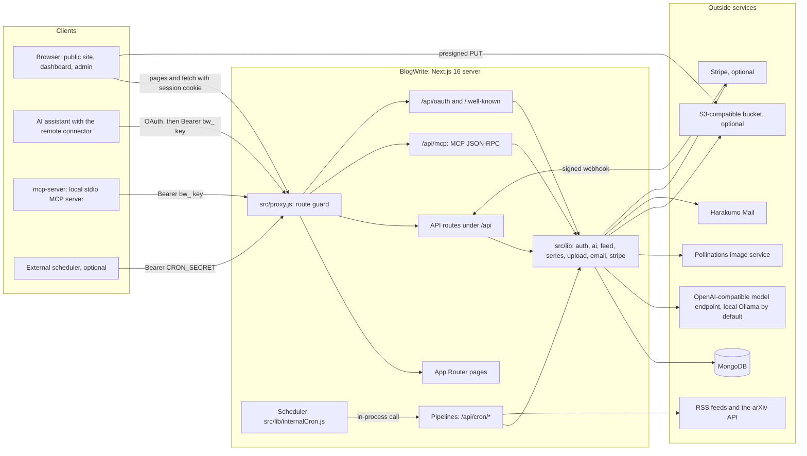
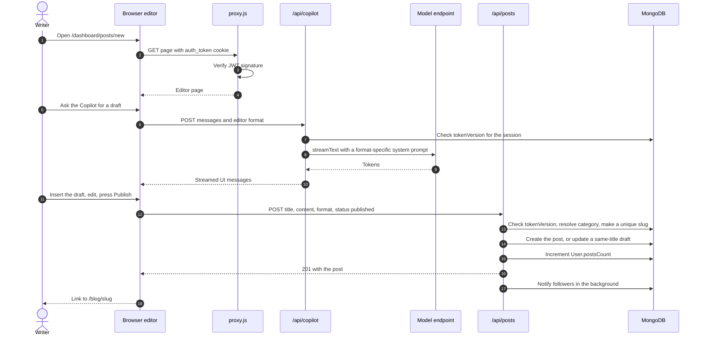
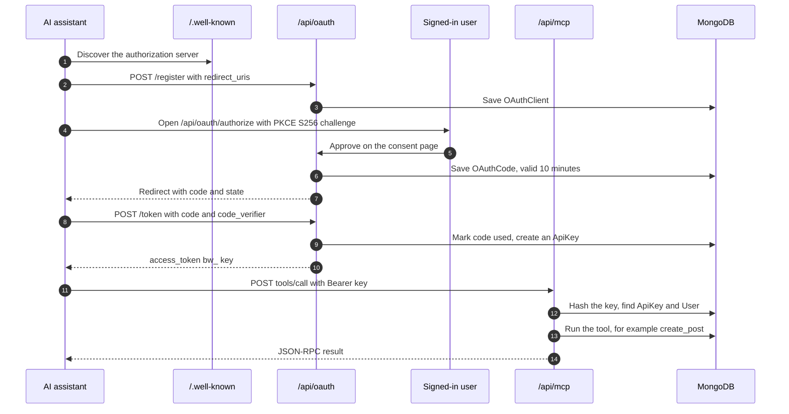

# BlogWrite architecture

BlogWrite is one Next.js 16 (App Router) server backed by one MongoDB database. The same
process serves the pages, the JSON API, a Model Context Protocol (MCP) endpoint for AI
assistants and an in-process scheduler that runs the content pipelines. A separate small
Node package, `mcp-server/`, lets a desktop AI assistant talk to an instance over stdio.

This file describes the parts and how they talk. The data model, flows, permissions and
limits are in [SYSTEM-DESIGN.md](SYSTEM-DESIGN.md); the reasons are in
[DECISIONS.md](DECISIONS.md).

## The parts at a glance

| Part | Where | What it does |
| --- | --- | --- |
| Pages | `src/app/**/page.js` (49 pages) | Client components that fetch the JSON API with `fetch` and SWR (`src/hooks/useSWRFetch.js`). |
| Route guard | `src/proxy.js` | Next.js 16 proxy. Verifies the JWT cookie (signature only, no database), redirects anonymous visitors from private pages to `/login`, returns 401 for private API routes, and lets Bearer `bw_` requests through to the handlers. |
| API routes | `src/app/api/**/route.js` (57 route files) plus `robots.txt`, `sitemap.xml` and two `/.well-known` routes | JSON endpoints. Each handler connects to MongoDB (`src/lib/db.js`) and checks its own permissions. |
| Remote MCP | `src/app/api/mcp/route.js` | MCP JSON-RPC: an SSE stream (`GET`) with messages posted back (`POST ?sessionId=`), or a single stateless `POST`. Five tools. |
| OAuth server | `src/app/api/oauth/*`, `src/app/.well-known/*` | Dynamic client registration, consent page, authorization code with PKCE, token exchange. The access token is a `bw_` API key. |
| Scheduler | `src/instrumentation.js` starts `src/lib/internalCron.js` | Checks every 30 seconds and, on the hour (UTC), calls the due `/api/cron/*` handlers in-process, one at a time. |
| Pipelines | `src/app/api/cron/*` | `fetch-news`, `fetch-research`, `generate-topics`, `generate-posts`, `generate-series`. Also callable over HTTP with the cron secret. |
| Local MCP server | `mcp-server/` | Stdio MCP server with 33 tools that call the HTTP API with a personal API key. |
| Data | `src/models/*.js` (23 Mongoose models) | Everything lives in MongoDB, including rate-limit counters and scheduler state. |

## Pages

All pages are client components. Access is decided by `src/proxy.js`:

- **Open to anyone:** `/`, `/explore`, `/pulse`, `/learn`, `/learn/[slug]`, `/blog/[slug]`,
  `/profile/[username]`, `/login`, `/signup`, `/forgot-password`, `/reset-password/[token]`.
  Signed-in visitors to the three sign-in pages are sent to `/dashboard`.
- **Sign-in required (anonymous visitors go to `/login`):** every other page. That includes
  `/dashboard/*` (posts, new post, edit, product launch, analytics, API keys, billing,
  bookmarks, explore, feedback, messages, notifications, profile, profile design, projects,
  reader view, research, settings, support) and, as the proxy is written today, also
  `/about`, `/contact`, `/help`, `/privacy`, `/terms`, `/cookies` and `/feedback`.
- **Admin:** `/admin/*` (overview, automation, AI generate, users, posts, billing, contacts,
  feedback, categories). The proxy only requires a session. The admin layout hides the
  console from non-admins in the browser, and every `/api/admin/*` handler loads the user
  from MongoDB and requires `role: 'admin'`. The categories page is a "coming soon"
  placeholder.

The editor (`src/app/dashboard/posts/new/page.js`, `src/components/editor/*`) has five
formats: Rich Text (TipTap), Markdown, LaTeX, HTML/CSS/JS (code editor with live preview)
and Product Launch. `CopilotChat.js` streams the AI co-writer beside it.

The reader (`src/app/blog/[slug]/page.js`) renders Markdown, Rich Text and LaTeX to HTML,
passes it through `sanitizeRichHtml` (`src/lib/sanitize.js`), and shows HTML-format posts
inside an iframe sandboxed without `allow-same-origin`. KaTeX renders math and Mermaid
renders diagrams (`src/lib/mermaid-sanitize.js` repairs common model mistakes first).

## API routes

| Group | Routes | Who may call |
| --- | --- | --- |
| Accounts | `POST /api/auth/signup`, `login`, `logout`, `logout-all`, `forgot-password`, `reset-password`; `GET /api/auth/me`; `GET POST DELETE /api/auth/api-keys` | Public for sign-up, sign-in and reset (rate-limited); session for the rest |
| Posts | `GET POST /api/posts`; `GET PUT DELETE /api/posts/[id]`; `POST .../like`, `.../bookmark`, `.../pin`; `GET POST DELETE .../comments` | Reads public; writes need a session; edit and delete need the author or an admin |
| Discovery | `GET /api/feed`, `/api/search`, `/api/news`; `GET POST /api/series`; `GET PUT DELETE /api/series/[id]`; `GET /api/research`, `/api/stats` | Feed, search, Pulse news and series reads are public (the feed personalises when signed in); research, stats and series writes need a session |
| Saving | `POST /api/news/[id]/save`, `/api/research/[id]/save`; `GET /api/users/me/bookmarks` | Session |
| People | `GET /api/users/[username]`; `POST .../follow`; `GET PUT /api/users/me`; `GET PUT /api/notifications` | Profile read public; the rest need a session |
| Messages | `POST /api/contact` (public contact form); `GET PUT /api/contact/inbox`; `POST GET /api/feedback` | Contact form public; inbox and sending feedback need a session; reading feedback needs an admin |
| AI | `POST /api/copilot` (streaming chat), `POST /api/copilot/image`, `GET /api/copilot/topics`, `POST /api/ai` | Session |
| Media | `POST /api/upload` (server upload), `POST /api/upload/presign` (direct browser upload) | Session |
| Billing | `POST /api/billing/checkout`, `POST /api/billing/mock-checkout/success`, `POST /api/billing/webhook` | Session; webhook verified by Stripe signature |
| Admin | `GET PUT /api/admin`; `GET POST PUT /api/admin/automation`; `GET .../logs`; `POST .../trigger`; `POST .../generate`; `POST /api/admin/series/generate` | Admin (checked against MongoDB) |
| Pipelines | `GET POST /api/cron/{fetch-news, fetch-research, generate-topics, generate-posts, generate-series}` | Cron secret |
| MCP and OAuth | `GET POST OPTIONS /api/mcp`; `POST /api/oauth/register`, `GET /api/oauth/authorize`, `POST /api/oauth/approve`, `POST /api/oauth/token`; `GET /.well-known/oauth-authorization-server`, `/.well-known/oauth-protected-resource` | API key for `/api/mcp`; session for consent; the rest public |
| Utility | `GET /api/favicon?url=` (finds a site's icon), `/robots.txt`, `/sitemap.xml` | Favicon needs a session (proxy); the other two are public |

## Database

One MongoDB database through Mongoose 9 (`src/lib/db.js` caches the connection on
`global.mongoose`). The 23 collections fall into five groups; every field is listed in
[SYSTEM-DESIGN.md](SYSTEM-DESIGN.md#data-model).

- **People and content:** `User`, `Post`, `Category`, `Series`, `Comment`.
- **Engagement:** `Like`, `Bookmark`, `Follow`, `ReadingHistory`, `Notification`,
  `ContactMessage`, `Feedback`.
- **Curated feeds:** `NewsArticle`, `ResearchPaper`, `SuggestedTopic`.
- **Security:** `ApiKey`, `OAuthClient`, `OAuthCode`, `PasswordReset`, `RateLimit`.
- **Automation:** `AutomationConfig`, `AutomationState`, `CronLog`.

Search uses a MongoDB text index on post title, content and tags. Expiring records
(`OAuthCode`, `PasswordReset`, `RateLimit`) use TTL indexes.

## Storage

`src/lib/storage.js` and `src/lib/upload.js` talk to any S3-compatible bucket through the
`STORAGE_*` variables:

- The browser uploader (`src/components/shared/ImageUploader.js`) asks
  `/api/upload/presign` for a one-hour presigned PUT URL and uploads straight to the bucket.
- Server-side uploads (profile images, AI cover images) go through `uploadFile`.
- Without a bucket, the server stores images up to 2 MB inline as `data:` URLs in MongoDB,
  and the browser uploader keeps its local preview instead. This is meant for trying
  BlogWrite locally.

## Sign-in

Email and password only (`authProvider` allows one value, `local`). Passwords are hashed
with bcrypt (cost 12). A successful sign-in sets an `auth_token` cookie holding an HS256 JWT
(`src/lib/auth.js`, `jose`), httpOnly, `SameSite=Lax`, `Secure` in production, valid for
seven days. The token carries `userId`, `email`, `role` and `tv` (the user's
`tokenVersion`); bumping `tokenVersion` on password reset or "log out everywhere"
invalidates older tokens. Personal API keys (`bw_` plus 64 hex characters, stored as
SHA-256 hashes) authenticate the MCP endpoint.

## Payments

Optional. `src/lib/stripe.js` turns real billing on only when `STRIPE_SECRET_KEY` and
`STRIPE_PRICE_ID_WRITER` are both set. Then `/api/billing/checkout` opens a Stripe Checkout
subscription for the $1/month Writer plan and `/api/billing/webhook` updates
`User.subscription` from signed Stripe events. Without Stripe, "Upgrade" goes to a built-in
checkout simulator that moves no money and is refused once Stripe is configured. The
Writer plan is a badge: `PLAN_LIMITS` is defined but no route enforces it.

## Outside services

| Service | Used for | Code | Without it |
| --- | --- | --- | --- |
| MongoDB | All data | `src/lib/db.js` | Nothing works (`MONGODB_URI` is required) |
| OpenAI-compatible model endpoint | Co-writer, AI actions, every pipeline | `src/lib/aiProvider.js` (`OLLAMA_*` or `AI_*`) | AI calls fail; the rest of the site works |
| Pollinations | AI cover images (prompt is sent there) | `generateCoverImage` in `src/lib/ai.js` | Posts are saved without a cover |
| S3-compatible bucket | Uploaded and generated images | `src/lib/storage.js`, `src/lib/upload.js` | Small images stored inline |
| Harakumo Mail | Welcome, password reset, subscription emails | `src/lib/email.js` (`HARAKUMO_API_KEY`) | Emails skipped with a warning, so reset links are not sent |
| Stripe | Writer subscription | `src/lib/stripe.js`, `src/app/api/billing/*` | Checkout simulator |
| RSS feeds (21 in `src/lib/newsSources.json`) | Pulse | `src/lib/newsFetcher.js` | Pulse stays empty |
| arXiv API | Research | `src/lib/researchFetcher.js` | Research stays empty |
| Any site | Product icons | `/api/favicon` | No icon |

There is no realtime channel for readers and writers: notifications are fetched when the
dashboard loads. The only streams are the Copilot response and the MCP SSE transport.

## The main request: writing and publishing a post

A second path, used by AI assistants, goes through the remote connector:

## Deployment shape

- `next.config.ts` sets `output: 'standalone'` and three security headers
  (`X-Frame-Options: DENY`, `X-Content-Type-Options: nosniff`,
  `Referrer-Policy: origin-when-cross-origin`).
- The `Dockerfile` builds on `node:20-alpine` and runs `node server.js` on port 8080.
  `NEXT_PUBLIC_APP_URL` is a build argument because it is inlined into the client bundle.
- The scheduler runs in every server process unless `ENABLE_INTERNAL_CRON=false`, so a
  deployment with several instances on one database must switch it off on all but one.
